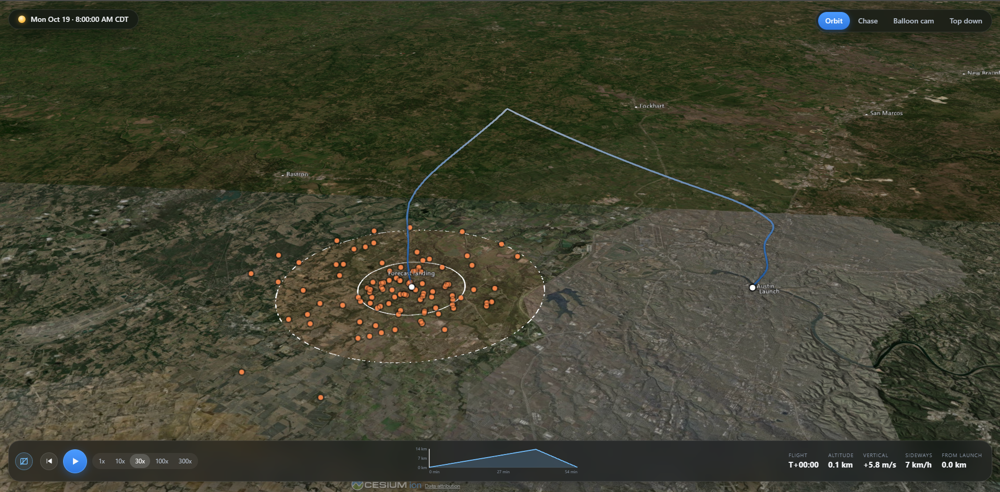
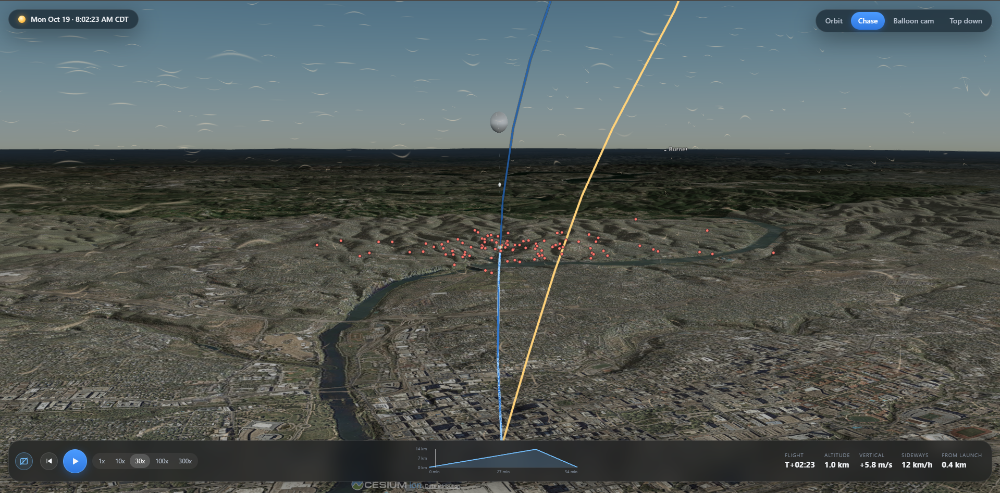
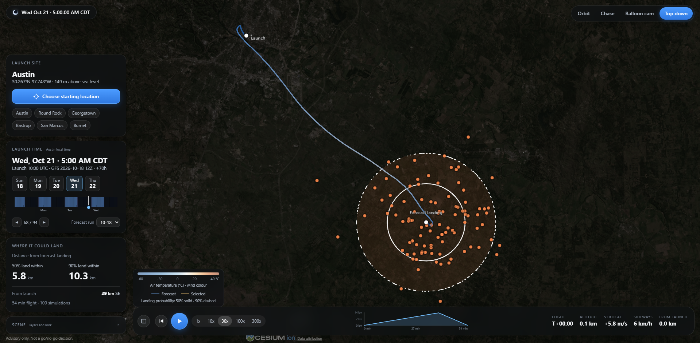
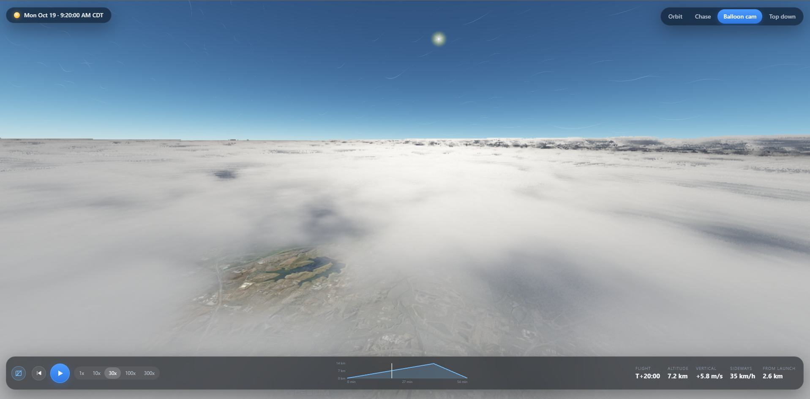

# Launch Planner

Choose a launch location and time to explore a forecast route, plausible alternative flights, and landing uncertainty in an interactive 3D map.

## Features

- **4D flight simulation:** follows winds that change with location, altitude, and time.
- **Learned uncertainty:** samples forecast wind errors to simulate 100 possible flights and estimate 50%/90% landing zones.
- **Interactive viewer:** orbit, chase, balloon cam, and top-down perspectives with timeline scrubbing and selectable flights.
- **Weather visualization:** satellite terrain, temperature-coloured wind ribbons, and illustrative clouds driven by forecast humidity.

## Screenshots

| Forecast route and landing zones | Chase view |
| --- | --- |
|  |  |
| **Launch controls and top-down view** | **Balloon cam above the clouds** |
|  |  |

## How it works

Archived NOAA GFS forecasts drive a vectorized Python simulator. A gradient-boosted wind-error model uses forecast lead time, season, wind speed, and GEFS spread to generate alternative wind profiles. The resulting flights and landing distribution are displayed with CesiumJS and Three.js.

The model is evaluated on later years than it trains on, including checks against soundings and real balloon tracks.

## Run locally

```powershell
conda env create -f environment.yml
conda activate balloon
python -u -W ignore -m scripts.serve
```

Open **http://localhost:8000**. The server needs prepared GFS/GEFS files and `wind_error_full.joblib` in `~/balloon-data` (or `BALLOON_DATA_DIR`); these are not included in the repository. Internet access is required for map imagery, elevation, and viewer libraries. See [web/README.md](web/README.md) for viewer details and checks.

To serve other devices on the same network, add `--host 0.0.0.0` and open `http://<server-local-ip>:8000` on those devices. Weather data and the model stay on the server.

## Future plans

- Rank launch sites and hours by landing suitability.
- Improve real-flight calibration and model errors that vary across space and time.
- Add terrain-aware touchdown and uncertainty in balloon ascent, burst altitude, and descent.
- Simplify data setup and add automatic forecast updates and shareable hosting.
